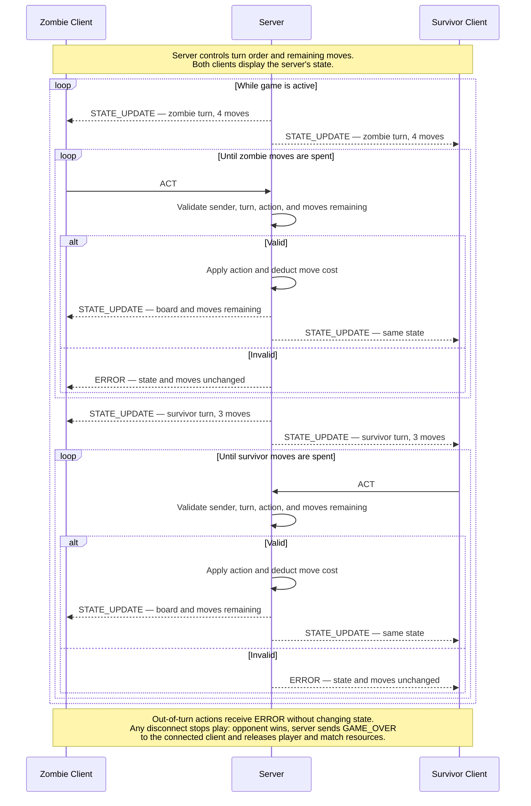

## 3. Game Behavior & Server Concurrency Architecture (Sprint 2 Deliverable)

### 3.1 Server Concurrency Strategy
- **Architecture Choice:** Multi-Threading (`threading.Thread`) - I have chosen multi threading. The coding is simpler, and while it is less scalable, I only need 2 players at a time and simple turn based mechanics. 
- **Synchronization Logic:** To prevent race conditions and maintain state between turns, threading.lock will be used. This will allow us to mutate the gamestate safely. Since both players take their turn one at a time, state management should be simple, and easier to implement using multi threading. 

### 3.2 State & Score Synchronization Across Clients
- **Turn Enforcement:** When an ACT message arrives, our server checks the port it arrived at against the player_ID and player_role, to ensure that they match and are expected. We check state to ensure it is an in turn message by checking active_role, and act accordingly. 
- **Score & Board Synchronization:** Every valid move by either player triggers an updated state broadcast. Each client node parses JSON, clears its terminal output, and redraws the board with the updated state.

--- 
